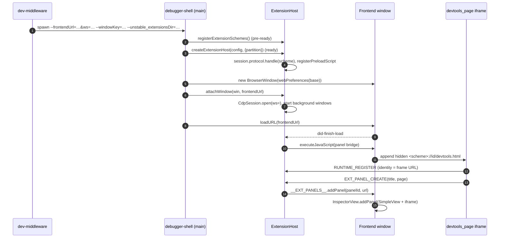
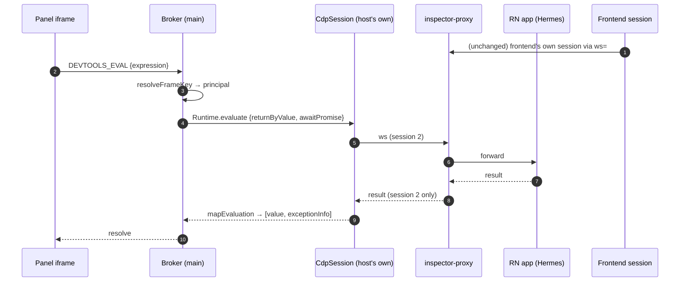
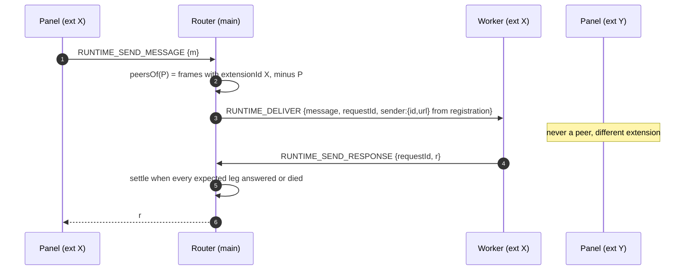
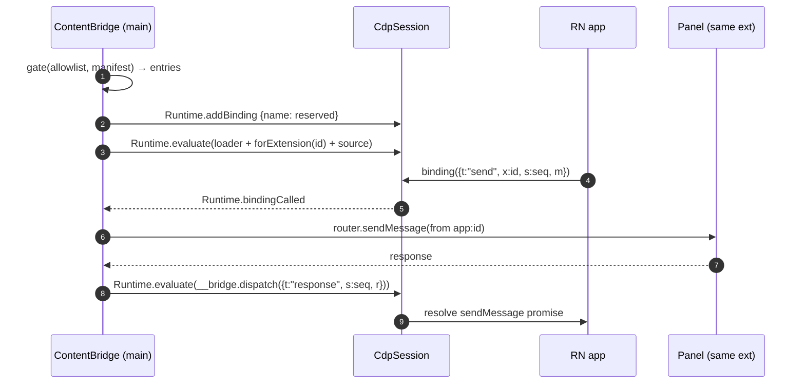

# Chrome DevTools extensions in `@react-native/debugger-shell`

> Architecture specification for moving this repository's extension host into
> `packages/debugger-shell`. It is opt-in behind a CLI flag, and one entry file is its only
> public surface. The structure follows the React Native RFC template (Summary → Detailed
> design → Drawbacks → Alternatives → Adoption → Unresolved questions), with Goals/Non-goals
> taken from Google-style design docs. Each claim about current behaviour cites a source file in
> this repository. Each claim about upstream cites `react/react-native@3846064`.

## 1. Summary

React Native DevTools is the Chrome DevTools frontend. This repository runs **unmodified,
unpacked Chrome MV3 DevTools extensions** in that frontend. GraphQL Network Inspector, Altair
and two in-house extensions work today. Four pieces make that possible:

- a privileged custom scheme that serves the extension files;
- a `chrome.*` shim, injected by a preload;
- a panel bridge that adds real DevTools tabs;
- a CDP client for `inspectedWindow` and `network`.

This spec moves that host into the upstream Electron shell as:

- **one public module**, `src/electron/extensions/index.js`, with three functions and one
  options constant;
- **about six guarded call sites** in the existing upstream files;
- **zero behaviour change** when the flag is absent.

## 2. Context

| | Upstream `debugger-shell` | This repository |
| --- | --- | --- |
| Language / build | Flow `strict-local`. RN's per-file Babel build, no bundler. `.d.ts` emitted | CommonJS, no build |
| Electron | 43.0.0 | 38.8.6 |
| Launched by | dev-middleware: `--frontendUrl=… --windowKey=…`, gated by `enableStandaloneFuseboxShell` | `npm start`; frontend URL from env |
| Session | `persist:react-native-devtools` | default session (nothing sets a partition) |
| Windows | one per `windowKey`, reused on `second-instance` | one global `currentWindow` |
| Frontend host | stock `InspectorFrontendHostStub`, decorated with `bringToFront` | full replacement (`src/preload/frontend-host.js`) |
| CDP | the frontend dials the `ws=` Metro gave it | the frontend dials Metro's `ws=` directly (the shell picks the target from `/json/list`); the host opens its own second session (§5.6) |
| Persistence | `SettingsStore` (JSON in `userData`) | `electron-store`; frontend prefs in `localStorage` |
| Size | 572 lines across 8 files | ~14k lines of source, 45 test files (10 real-Electron) |

Two upstream facts shape this design:

1. **Multiple debuggers per target.** When the standalone shell is on, the inspector proxy
   leaves `supportsMultipleDebuggers` as the app reports it (`Device.js:559`), and
   jsinspector-modern reports it as `true` (`InspectorPackagerConnection.cpp:268`). The host
   can therefore open **its own CDP session**. It does not need to sit in the middle of the
   frontend's session or reuse it through the frontend's SDK (§5.6). Network events and binding
   notifications are scoped per session (`NetworkHandler.cpp:46`, `RuntimeAgent.cpp:121`).
2. **Strict argument parsing.** `handleLaunchArgs` calls `util.parseArgs` in strict mode
   (`MainInstanceEntryPoint.js:31`; see the comment at `:40`), so an unknown `--flag` throws. Extension flags have to be
   added to its option table (§5.2).

## 3. Goals

- G1. With the flag set, unpacked MV3 extensions load from a directory. They get
  `devtools_page`, panels, theme, `inspectedWindow.eval/reload`, `devtools.network`,
  `webRequest` (observe-only), runtime messaging, `storage`, `i18n`, an always-on background
  context, Tier-2 shims and opt-in content scripts. This is the same surface as
  `docs/features/README.md`.
- G2. **Encapsulation.** Nothing outside `src/electron/extensions/` imports from
  `extensions/internal/`. The upstream files change only at the call sites in §5.2.
- G3. **Flag off means unchanged upstream behaviour.** No scheme is registered and no
  preload, IPC handler, window or socket is added.
- G4. **No frontend fork.** Only the stock `@react-native/debugger-frontend` is used.
- G5. **Upstream-grade security.** `sandbox: true`, a session-scoped scheme, IPC scoped to
  each WebContents, and identity derived from the calling frame.

## 4. Won't do

These are decided; v1 does not include them. Items marked 🚷 are impossible by construction:
RN DevTools has no anchor for them (`docs/OVERVIEW.md`, "the anchor list").

| Won't do | Why |
| --- | --- |
| Host replacements unrelated to extensions: native context menu, frontend save dialog, `getHostConfig` overrides, zoom, prefs IPC | Behaviour changes for every user. Each can be its own upstream PR. With the flag on, the stock host stays and is **not even decorated** (§5.4) |
| Extensions in more than one window | v1 attaches to the **first** window; later windows stay stock. Per-window host state is the costliest part of the refactor (§5.3) |
| Metro / dev-middleware changes: target discovery, passing the flag through, an `enableExtensions` experiment | Out of scope for this PR; it moves later. The shell uses only `--frontendUrl`'s `ws=`, plus one read-only `/json/list` lookup to check that target's capability (§5.6) |
| Install/uninstall/reload UI, consent dialog, folder watcher, CRX / Web Store install | Dropping a folder into the directory is the install, as it is today |
| MV3 worker eviction and wake, `onSuspend` | The context is always-on: a superset of what a DevTools host needs |
| Per-extension origin isolation for reads (`SECURITY-PLATFORM.md` L6) and per-extension `WebContentsView` (L8) | L6 is low value. L8 breaks `Panel.onShown(window)` |
| Porting `src/tools/fake-cdp.js` | A developer tool for this prototype only |
| 🚷 `panels.elements.*`, `getSelectedNode`, `webRequest` blocking, DOM content scripts (`css`, isolated worlds, URL `matches`), `action` popup, `contextMenus.onClicked`, `sidePanel.open`, real `chrome.windows` | No Elements panel, no `Fetch` domain, no document, no browser UI |

## 5. Detailed design


Grey boxes are upstream and unchanged; blue boxes are added behind the flag. The frontend's
internals stay in its renderer: main reaches them only by injecting the panel bridge (§5.4), and
everything else talks to main over IPC, which the broker checks per frame (§5.5).

### 5.1 Public API: `src/electron/extensions/index.js`

This file is the only one other code may import. Everything else lives under
`extensions/internal/`. The package's `exports` map stays as it is (`.` → node/electron entry),
so consumers outside the package cannot reach the internals either.

```js
/** @flow strict-local */

// Options to spread into every util.parseArgs() that sees launch argv.
// Upstream's handleLaunchArgs parses strictly, so unknown flags throw.
export const EXTENSION_LAUNCH_OPTIONS = {
  unstable_extensionsDir: {type: 'string'},   // presence = feature on
  unstable_contentScripts: {type: 'string'},  // comma list of ids, or "<all_rn_targets>"; default none
};

export type ExtensionLaunchConfig = Readonly<{
  extensionsDir: string,
  contentScripts: ReadonlyArray<string>,
}>;

// Pure. null = feature off. Called with process.argv BEFORE the single-instance lock.
export function parseExtensionLaunchConfig(argv: ReadonlyArray<string>): ?ExtensionLaunchConfig;

// Must run before app 'ready' (protocol.registerSchemesAsPrivileged). Idempotent.
export function registerExtensionSchemes(): void;

export type ExtensionHost = {
  // Adds what extension iframes need. The base preload is left untouched (§5.4).
  webPreferences(base: WebPreferences): WebPreferences,
  // v1: the first call wins; later windows get null and stay stock.
  // Reads ws= from frontendUrl to open the host's own CDP session (§5.6).
  attachWindow(win: BrowserWindow, frontendUrl: string): ?{detach(): Promise<void>},
  dispose(): Promise<void>,
};

// Call after app 'ready'. Every service is created here; nothing runs at import time.
export function createExtensionHost(
  config: ExtensionLaunchConfig,
  options: Readonly<{partition: string}>,
): ExtensionHost;
```

`isInternalWindow` from the earlier sketch was dropped. Worker windows close when their window
detaches (§5.3), so upstream's `window-all-closed → app.quit()` keeps working unchanged. The
`second-instance` lookup ignores those windows anyway, because they have no `windowMetadata`.

### 5.2 Upstream call sites

```diff
 // index.flow.js — before requestSingleInstanceLock()
+import {parseExtensionLaunchConfig, registerExtensionSchemes} from './extensions';
+if (parseExtensionLaunchConfig(process.argv.slice(app.isPackaged ? 1 : 2)) != null) {
+  registerExtensionSchemes();
+}

 // MainInstanceEntryPoint.js
+import {EXTENSION_LAUNCH_OPTIONS, createExtensionHost, parseExtensionLaunchConfig} from './extensions';
+const extensionConfig = parseExtensionLaunchConfig(process.argv.slice(app.isPackaged ? 1 : 2));
+let extensionHost = null;

   options: {frontendUrl: …, windowKey: …, 'remote-debugging-port': …,
+    ...EXTENSION_LAUNCH_OPTIONS},

-  webPreferences: {partition: PARTITION, preload: require.resolve('./preload.js')},
+  webPreferences: extensionHost?.webPreferences(base) ?? base,

+  extensionHost?.attachWindow(frontendWindow, frontendUrl);   // before loadURL
   frontendWindow.loadURL(frontendUrl);

 app.whenReady().then(() => {
+  if (extensionConfig) extensionHost = createExtensionHost(extensionConfig, {partition: PARTITION});
   handleLaunchArgs(…);

+app.on('will-quit', () => { void extensionHost?.dispose(); });
```

**The flag applies per process.** The scheme has to be registered before `ready`, so only the
argv of the **first** process counts. A `second-instance` launch with a different flag value is
ignored, and a single `console.warn` says so. Q4 asks whether to register the (inert) scheme
unconditionally to remove this rule.

### 5.3 Module layout and ownership

```
src/electron/extensions/
├── index.js                     public API (§5.1), the only file imported from outside
└── internal/
    ├── ExtensionHost.js         composition root: builds services, attachWindow, dispose
    ├── scheme/                  privileges, session protocol.handle, containment, CSP, bootstrap/i18n paths
    ├── registry/                folder scan, manifest + i18n localization, install state
    ├── broker/                  per-WebContents IPC, frame principals, grants, delivery scope
    ├── frontend/                panel host, panel-bridge source (main world), theme host
    ├── contexts/                message router, context registry/request, background + options hosts
    ├── cdp/                     CdpSession, inspectedWindow, network model/service
    ├── content/                 content-script registry, gate, bridge, in-app loader
    ├── services/                storage, notifications, alarms clock, downloads/save, tabs
    ├── preload/                 bundled entry: protocol dispatch → extension frame | frontend bridge
    └── shim/                    chrome.* namespaces (today's src/chrome-shim, unchanged: pure)
```

Each current file maps one-to-one into this tree (Appendix A). The real refactor is **lifetimes**.
Today ipc.js builds the service graph when it is imported, and about ten modules keep lazy
`instance` singletons (among them `background-host`, `content-bridge`, `context-registry`,
`notification-host`, `save-service`, `tab-host`, `options-host`, `install-state`). After the
move, everything is created by `createExtensionHost`, takes its dependencies as arguments, and is
released by `dispose()`:

| Scope | Created by | Owns |
| --- | --- | --- |
| **Process** | `registerExtensionSchemes()` | scheme privileges, nothing else |
| **Host** (app) | `createExtensionHost()` | session protocol handler, extension registry, CSP cache, storage service and its persistence, install state, message router, context registry, notifications, save service |
| **Attachment** (one window in v1) | `attachWindow()` | IPC broker on that WebContents, panel host, theme state, `CdpSession` for its `ws=`, network service, content bridge, background and options windows |

Background workers belong to the attachment, not the host. `detach()` runs on the window's
`closed` event and closes them, which lets `window-all-closed` fire. Reloading the frontend is not
a detach, so workers survive reloads, as they do today. This drops the macOS "workers outlive the
window" behaviour (`docs/features/BACKGROUND-WORKER.md` § App shutdown). Upstream quits on
`window-all-closed` on every platform anyway.

### 5.4 Frames, preload and frontend integration

| Context | Where | Preload part |
| --- | --- | --- |
| Frontend | main frame of the upstream window | `frontendBridge`: exposes `__RN_DEVTOOLS_EXTENSIONS__ = {reportTheme, reportPanelVisible}`, nothing more |
| devtools page, panel pages | `<scheme>://<id>/…` iframes inside the frontend | `extensionFrame`: the `chrome.*` shim, permission gate, startup delivery queue |
| Background context | main frame of a hidden window, `<scheme>://<id>/__background__?script=…` | `extensionFrame` |
| Options page | its own window | `extensionFrame` |
| Content scripts | inside the app's Hermes runtime, over CDP | none (in-app loader, §5.8) |

- **The stock host is left alone.** Extension hosting needs nothing from
  `InspectorFrontendHost`. The panel bridge talks to `InspectorView` directly, and the host
  reaches the frontend through its own two-method global. Upstream's
  `reactNativeDecorateInspectorFrontendHostInstance` (with `bringToFront`) keeps working, and the
  flag does not change it. The `HOST_EVENT` dispatch channel is used only for `showPanel` driven
  by `DEVTOOLS_SHOW_PANEL`, a development convenience, so it is **dropped**.
- **Getting the preload in.** Preferred: `session.registerPreloadScript({type: 'frame', filePath})`
  on the partition, so `webPreferences.preload` stays upstream's. `webPreferences(base)` then only
  adds `nodeIntegrationInSubFrames: true`, which is load-bearing: without it no preload runs in
  extension iframes (measured, `src/main/frame-security.js:22`). If session preloads cannot be
  used (Q3), fall back to a combined bundled preload that `require`s upstream's `preload.js`
  logic.
- **`sandbox: true`.** A sandboxed preload can only `require('electron')`, so the extension
  preload must be **one self-contained bundled file**. RN's build is per-file Babel with no
  bundler (`scripts/build/config.js:44`). Q2 decides how to add one step for a single file. This is
  the one hard prerequisite: an unsandboxed preload in a packaged upstream shell is not
  acceptable (`docs/SECURITY-PLATFORM.md` L7).
- **Panel bridge.** On every `did-finish-load` of the attached window, main runs
  `executeJavaScript(config + PANEL_BRIDGE_SOURCE)` (`src/main/panel-host.js:67`). The bridge
  then:
  - waits for `.main-tabbed-pane`;
  - imports the frontend's own `ui/legacy/legacy.js` and `theme_support.js`, resolved against
    `document.baseURI` (today they are hard-coded to `/rozenite/…`, `panel-bridge.js:30,45`);
  - creates hidden devtools-page iframes and replays the panels already registered.

  These are private frontend internals (Q6).



### 5.5 Scheme, files and IPC broker

- **Scheme.** Registered with `standard`, `supportFetchAPI` and `bypassCSP`. It is handled with
  `protocol.handle` on **the partition's** `session.protocol`, not the global module
  (`extension-server.js:441`). `<scheme>://<id>/<path>` maps to `<extensionsDir>/<id>/<path>`.
  The id is the folder name and must match `^[A-Za-z0-9._-]+$`. Containment works on the
  `realpath` of both root and target, and symlinked roots are refused. Every response, 404s
  included, carries the extension's CSP. The default is MV3's; a policy that weakens it is
  replaced (`src/shared/csp.js`). Two paths are synthesized and cannot be shadowed by files: the
  background bootstrap document and the i18n bundle.
- **Persistence.** Two stores replace `electron-store`, both under
  `userData/extensions/`. Both already take an injected store
  (`createInstallState(store)`, `openPersistence(id, area)`), so only the adapters are new. The
  open question is whether to reuse upstream's `SettingsStore` or write a JSON-file adapter (Q10).
  - Install state is `{[id]: {version, installedAt}}`.
  - Storage is one file per `(id, area)`, written with a 250 ms debounce and flushed in
    `dispose()`.
- **IPC.** Handlers are registered on **`win.webContents.ipc`** and on each worker or options
  window's `webContents.ipc`, never on the global `ipcMain`. The result:
  - no clash with upstream's `ipcMain.on('bringToFront')`;
  - no duplicate-registration throws;
  - `detach()` removes them.

  Identity rules carry over unchanged:
  - The extension id comes from `new URL(senderFrame.url).hostname`, never from the payload.
  - The frame key is `${sender.id}:${frameId}`, pinned to the `WebFrameMain` that registered
    under it.
  - Grants are computed from the manifest **on disk** and enforced both in main and in the shim.

```js
// carried over verbatim (src/main/ipc.js:273)
const resolveFrameKey = (event) => {
  const key = `${event.sender.id}:${event.frameId}`;
  return principals.get(key) === event.senderFrame ? key : null;
};
```

These fixes are folded in while the code moves:
- `RUNTIME_REGISTER` also checks the scheme.
- Options and `tabs.create` windows get the deny-all `setWindowOpenHandler` and a same-extension
  navigation guard (L4).
- The save path uses `app.getPath('downloads')`.
- `node-fetch` is replaced by `session.fetch`.

### 5.6 CDP: the host's own session

The bridge this replaced (`src/main/cdp-bridge.js`, deleted) put itself between the frontend
and the app:
- it found the target through `/json/list` and took `pages[0]`;
- it listened on `:9223`;
- it multiplexed host commands with ids ≥ `HOST_ID_BASE = 1e15`.

**Decision: the host opens a second, independent session** to the inspector URL from `ws=`.
Upstream supports multiple debuggers per target, so the shell needs no frontend URL rewrite, no
listening socket, no Origin gating on our side, and no ownership/4001 logic.

**Why not reuse the frontend's own connection?** It is technically possible (§9), but the second
connection wins on the points below.

| | Reuse the frontend's session (via its SDK) | Own second session (chosen) |
| --- | --- | --- |
| Lifetime | CDP exists only while the frontend page is loaded and connected. Every frontend reload drops the session's binding subscriptions and `Network.enable`, so app → panel messages and network events are lost until re-armed. Workers outlive reloads, so they would see gaps | Independent of the frontend. Reloads do not touch it, as with today's bridge |
| Coupling | UI internals (`legacy.js`), **plus** SDK internals (`TargetManager`, `router()`, `registerDispatcher`), **plus** a request/reply transport main → frontend main world → SDK → main | Only the CDP wire protocol. The consumers already take `sendCommand`/`onEvent` |
| Isolation | Host bindings and events land in the frontend's models | Per session: `Runtime.bindingCalled` goes only to sessions subscribed to that name (`RuntimeAgent.cpp:121`), and `Network.*` fans out to each enabled session (`NetworkHandler.cpp:46`). This fixes the binding leak described in `docs/LIMITATIONS.md` |
| Tests | Every CDP test needs the real frontend running | A fake inspector socket is enough (`tests/fake-rn-app.js`) |
| Works with an app that lacks `supportsMultipleDebuggers` | yes | no (see below) |

The host needs only two things from upstream's proxy:

- **An `Origin` header.** The proxy refuses a debugger socket whose `Origin` is neither the dev
  server's origin nor a loopback hostname (`InspectorProxy.js:503-519`). A missing `Origin` is
  refused too. The host sends `Origin: <dev server origin>`, taken from `frontendUrl`, so it needs
  the `ws` client package. dev-middleware already depends on `ws` in this monorepo.
- **The capability.** One read-only `GET <dev server>/json/list` before connecting. The host finds
  the entry whose `webSocketDebuggerUrl` equals `ws=` and reads
  `reactNative.capabilities.supportsMultipleDebuggers` (`InspectorProxy.js:277`). This is not
  target discovery: the shell never picks a target, it only checks the one it was given.

```js
// internal/cdp/CdpSession.js. Every CDP consumer depends only on this.
export type CdpSession = {
  sendCommand(method: string, params?: {...}, opts?: {timeoutMs?: number}): Promise<mixed>,
  onEvent(method: string | '*', handler: (params: mixed) => void): () => void,
  status(): {attached: boolean, target: ?{title: string, url: string}},
  close(): Promise<void>,
};
// open(): wsUrl = 'ws://' + new URL(frontendUrl).searchParams.get('ws')  (or wss=)
```

`inspected-window`, `network-model` and `content-bridge` already take `sendCommand`/`onEvent` by
injection, so moving them over is just rewiring. Reconnect: re-dial the same URL with back-off,
then emit `attach` again. Consumers already re-arm (`Network.enable`, `Runtime.addBinding`) on
attach and on `executionContextsCleared`.



The source answers most of M1. What is left is confirming it on a device (Q1). If the target
reports `supportsMultipleDebuggers: false` (an app older than the shell's RN release), or the
capability lookup fails, the host **does not connect**. Connecting would evict the frontend
(`Device.js:375`). CDP-backed APIs then fail with the reason, which matches today's
"no session" behaviour (`docs/LIMITATIONS.md`). Panels, storage and messaging keep working.

### 5.7 Messaging, background and storage

There is one router per host. A frame's peers are the other frames of the **same extension**
(`message-router.js:36`). Workers are hidden windows on the partition that load a synthesized
bootstrap from their own origin and get the same preload as panels. The route that would host
workers in the frontend was rejected: every frontend reload would kill them
(`docs/features/BACKGROUND-WORKER.md`). `onInstalled`/`onStartup` come from install state
compared against the manifest on disk, one delivery per launch.



### 5.8 Content scripts

Content scripts are on only for ids named in `--unstable_contentScripts`; the default is none.
The gate is a pure function (`content-gate.js`). Injection runs over the host's `CdpSession`:
`Runtime.addBinding` installs a reserved name, then one `Runtime.evaluate` runs the
loader + entry. The app gets a router seat `app:<id>`. **Hermes has no isolated worlds**, so
"ISOLATED" and "MAIN" both run in the app's global, and that is documented. Scripts are injected
again on `executionContextCreated`, deduplicated by content hash per context.



### 5.9 Configuration

Configuration has no `process.env` reads. All of it comes from `ExtensionLaunchConfig` and
`createExtensionHost` options. Test-only hooks are a non-exported internal options type that the
test harness can reach (§7).

| Today (env) | Upstream |
| --- | --- |
| `DEVTOOLS_EXTENSIONS_DIR` | `--unstable_extensionsDir` (required to enable) |
| `DEVTOOLS_CONTENT_SCRIPTS` | `--unstable_contentScripts` |
| `DEVTOOLS_FRONTEND_URL`, `_CDP_*`, `_METRO_*`, `_APP_FILTER`, `_DEVICE_FILTER`, `_CDP_BRIDGE` | dropped: comes from `--frontendUrl` |
| `DEVTOOLS_UI_LOCALE` | dropped: `app.getLocale()` |
| `DEVTOOLS_TABS_OPEN` | fixed to `none` in v1 (see Q11) |
| `DEVTOOLS_SHOW_PANEL`, `_HOST_CONFIG` | dropped |
| `DEVTOOLS_ALARM_CLOCK_SCALE`, `_TEST_OPEN_LOG`, `_TEST_SAVE_DIALOG` | test-only internal options; never read from env |

## 6. Security

The guarantees carry over unchanged. They are tested today in `tests/extension-frame-electron`,
`tests/delivery-scope` and `tests/background-worker-electron`.

- Extension pages have no Node or Electron surface. `contextIsolation`, `webSecurity` and named
  `invoke` channels only.
- Identity is derived from the frame, and grants from the manifest on disk.
- Network pushes are filtered by permission in main.
- Each extension gets its own CSP, and weaker policies are refused.
- Content scripts are off by default.

What changes:

| Change | Effect |
| --- | --- |
| `sandbox: true` with one bundled preload | A renderer compromise is no longer a Node compromise. Closes the main gap in `docs/LIMITATIONS.md` |
| Scheme handler and windows on the partition | No extension traffic on the default session |
| Per-WebContents IPC | Only the attached window and the host's own windows can call. No global handlers |
| The host's own CDP session | No listening socket; the F3 attack surface (`SECURITY-PLATFORM.md`) is gone |

Accepted, as today (`SECURITY-PLATFORM.md` §7):
- an extension can run JavaScript in the app (`eval`) and read its traffic;
- opted-in content scripts share the app's realm;
- extension A can read extension B's **files**, but not its storage or messages.

## 7. Testing

- **Pure modules.** These are ~35 `node:test` files covering the shim, router, gate, network
  model, CSP and i18n. They move to Jest beside their modules
  (`internal/**/__tests__/`). They need no Electron and no singleton stubbing, because every
  dependency is injected.
- **Real-Electron suites (10).** These boot a production-shaped shell headless and observe it as
  NDJSON. Upstream has no Electron tests, so the suites **stay in this repository as a conformance
  suite**. Its harness drives the fork's package through `createExtensionHost` plus the internal
  test options. It still patches one private Electron internal (`WebFrameMain.prototype.send`,
  to observe deliveries); the `ipcMain._invokeHandlers` patch is gone (a `wrapHandler` hook). Q7 asks
  whether RN CI can run them headless.
- **The Electron 38 → 43 delta** has to be measured again before PR 1:
  - the `console-message` signature;
  - `nodeIntegrationInSubFrames` together with `sandbox: true`;
  - `hasListener` across `contextBridge`;
  - `Notification.close`;
  - `session.registerPreloadScript` in subframes;
  - whether `webContents.ipc.handle` receives `invoke` calls from subframes (or whether `WebFrameMain.ipc` is needed).

## 8. Drawbacks

- **Frontend internals.** The panel bridge depends on internals the devtools-frontend team never
  promised: `InspectorView`, `SimpleView`, `.main-tabbed-pane` and `ThemeSupport`. A frontend
  refactor can break panels without any failure at build time (Q6).
- **Size.** The package grows from about 0.6k to about 14k lines, most of it the `chrome.*` shim.
  It still has to be reviewed even though it sits behind a flag.
- **Electron surface.** The feature needs one bundled file in a package that has no bundler, and
  it adds Electron features the shell does not use today: privileged schemes, subframe preloads
  and hidden windows.
- **Limits.** One window and always-on workers diverge from Chrome, and the divergences are
  documented rather than fixed.

## 9. Alternatives considered

| Alternative | Verdict |
| --- | --- |
| Electron's `session.loadExtension` | Rejected. Electron attaches `devtools_page` only to its **own** built-in DevTools, not to a frontend loaded as a page. Its API subset is also smaller than G1 |
| The frontend's own `ExtensionServer` (`setInjectedScriptForOrigin` / `addExtensions`) | Rejected; the prototype started this way. It only covers `chrome.devtools.*` (no runtime, storage or background), it needs a host-stored script injected into every extension frame, and it stays off until the host calls `InspectorFrontendAPI.setInspectedTabId` and the primary target has an inspectable URL. The RN build ships it: `entrypoints/main/main.js` calls `ExtensionServer.instance()`, and `addExtension` checks `primaryPageTarget()?.inspectedURL()` and `canInspectURL` before it calls `setInjectedScriptForOrigin`. What RN targets report as their inspected URL is unverified |
| Reuse the frontend's CDP connection through its SDK, as Chrome's own `ExtensionServer` does | **Viable, not chosen** (table in §5.6). Verified in the shipped `debugger-frontend` build: `core/sdk/sdk.js` and `core/protocol_client/protocol_client.js` are separate ES modules, importable the same way the panel bridge imports `legacy.js`. A target's `registerDispatcher(domain, d)` adds to a list of dispatchers instead of replacing the frontend's, `SessionRouter.sendMessage(sessionId, domain, method, params, cb)` sends raw commands, and `RuntimeModel.addBinding` exists. Rejected for its lifetime coupling, the extra transport hop, deeper reliance on private frontend internals, and heavier tests. Its one advantage, working with apps that lack multi-debugger support, can become a later fallback |
| Keep the MITM bridge (rewrite `ws=` to an ephemeral loopback port) | Rejected for upstream. It works and is tested, but it adds a listening socket, Origin gating, single-owner logic and host events leaking into the frontend |
| Background workers as hidden iframes in the frontend | Rejected. A frontend reload kills them |
| Shipping as a separate package (`@react-native/debugger-shell-extensions`) | Possible later. One `index.js` boundary makes that a mechanical move, but the call sites still have to live in the shell |
| A full `InspectorFrontendHost` replacement (today's preload) | Rejected for upstream; it is a behaviour change unrelated to extensions (§4) |

## 10. Adoption and delivery

Every PR leaves the flag-off path identical (G3):

0. **Discussion or draft PR** containing this spec, `index.js` with stub bodies, and the §5.2
   diff. It settles the flag name, scheme name, bundling step and session-preload choice.
1. Scheme + files + CSP, registry, broker, bundled sandboxed preload, panel bridge, theme.
   Extensions get tabs.
2. Router, storage, i18n, background workers, install state.
3. `CdpSession`, `inspectedWindow`, `devtools.network`, `webRequest` (after M1).
4. Content scripts.
5. Tier-2 shims: tabs, notifications, alarms, downloads, `options_ui`, and the inert shells.

Before PR 1, this repository is refactored in place to the §5.3 shape, so the existing tests
protect the restructure before the Flow and Electron 43 port.

**Structure: done.** `src/electron/extensions/{index.js, internal/…}` and the development shell
in `src/electron/shell/` (it stands in for upstream and uses the public API only); boundary
pinned by `tests/architecture-boundary.test.js`.
- `createExtensionHost` is the composition root: every service is created there, and nothing
  under `internal/` builds state at import.
- The internals read no environment. The shell maps `DEVTOOLS_*` to the host config
  (`extensionHostConfig()`), and test hooks are a third, internal-only argument.
- The extension preload is registered on the session, so the shell keeps its own
  `webPreferences.preload`. A session-registered frame preload runs in the frontend's main
  frame, its iframes and hidden windows (measured, Electron 38). This answers Q3.
- The scheme handler is registered on the session's `protocol`.
- Background workers belong to the attachment and close with the window. This changes one
  behaviour: on macOS, closing the window now stops the workers, and reopening it starts them
  again.
- `showPanel` goes through the panel bridge, not the shell's dispatch channel.
- One pre-existing router race was fixed. An empty `sendMessage` leg that settled after a real
  answer replaced it, and starting workers before the page made it reproducible.

**Per-WebContents IPC: done.** The broker collects its handlers once and installs them on
each WebContents the host owns (`broker.attachContents`): the attached frontend window, every
background window and every options window, each before it loads. Nothing under `extensions/`
touches `ipcMain` (asserted in `tests/architecture-boundary.test.js`). A WebContents nobody
attached, such as a second frontend window or a `chrome.tabs` window, gets "no handler" for
every extension channel.

**`CdpSession`: done** (`internal/cdp/cdp-session.js`). The host opens its own session to the
attached window's `ws=` with `Origin: <frontend URL origin>`, after a `/json/list` check of
`supportsMultipleDebuggers` before every dial. Without the capability it does not connect, and
CDP-backed APIs fail with the reason. Each new session sends `Runtime.enable` before it reports
attached, then `onAttach` fires: the network model re-enables `Network`, and the content bridge
re-adds its binding. The bridge on `:9223`, its Origin gate, ownership rule and `rn-cdp` CLI
are gone. The development shell now picks the target itself (`shell/frontend-target.js`) and
gives the frontend Metro's `ws=` directly, as dev-middleware does upstream. One consequence to
check on a device (Q1): dev-middleware forces `supportsMultipleDebuggers: false` unless the
`enableStandaloneFuseboxShell` experiment is on (`Device.js`), so a dev server without it gets no
host session.

**Bundled sandboxed preload: done** for this repository. `scripts/bundle-preload.js` (no
dependencies) bundles each preload's CommonJS graph into one file, and refuses to build if a
module needs anything a sandboxed preload's `require` lacks: anything but `electron`, `events`,
`timers` and `url`, or a non-literal `require`. Two bundles go to gitignored `dist/` folders:
the extension preload, registered on the session, and the development shell's own preload. The
frame policy is `sandbox: true` for every frame class. Measured on Electron 38 by the existing
Electron suites:
- the session preload still runs in `rozenite://` iframes with `nodeIntegrationInSubFrames`;
- `process.isMainFrame` is available sandboxed;
- `chrome.*`, messaging, ports, workers and options pages all work.

The shell rebuilds the bundles at startup when unpackaged, and so do the test harnesses. The
host refuses to start without its bundle. Upstream still needs Q2's answer for its own build.

The test harness no longer patches `ipcMain._invokeHandlers`: the broker takes a `wrapHandler`
hook instead.

**Still to do before PR 1**, all behaviour changes:
- launch flags instead of env (§5.9);
- document-relative frontend imports;
- the upstream partition;

## 11. Open questions

| # | Question | Leaning |
| --- | --- | --- |
| Q1 | **M1, now a device confirmation.** The source says: `Network.enable` is per session and events fan out to each enabled session; binding notifications go per subscribed session; the proxy needs an `Origin`. Still to confirm on a device: (a) `Network.getResponseBody` from session 2 for a request session 1 also saw; (b) the frontend's Network panel is unaffected by session 2 enabling or disabling; (c) a binding installed by session 2 still fires after the frontend reloads | Confirm before PR 3. Fall back to reusing the frontend's session (§9) only if one of these fails |
| Q2 | How is the one bundled preload built? Options: an esbuild/rollup step for one file in `scripts/build`, or a checked-in generated file | A build step, if RN maintainers accept it |
| Q3 | Does `session.registerPreloadScript({type:'frame'})` run in subframes with `nodeIntegrationInSubFrames`, and in what order relative to `webPreferences.preload`? | Preferred if it works, since upstream's preload stays as it is. **Answered for subframes (Electron 38, measured):** it ran in the frontend's main frame, its `rozenite://` iframes and a hidden window's main frame. Order: Electron documents session preloads as running before `webPreferences.preload`; not measured here. The restructured host relies on it; re-measure on Electron 43 |
| Q4 | Register the scheme unconditionally (it is inert without a handler) so a `second-instance` launch can turn extensions on? | No for v1 (G3); revisit |
| Q5 | Scheme and reserved-path names (`rozenite://`, `__rozenite_background__`, `__rozenite_theme`) | Neutral names, e.g. `rn-devtools-ext://`, `__background__` |
| Q6 | Can the devtools-frontend team expose a supported hook for adding a panel and reading the theme, instead of `legacy.js` internals? | Ask in step 0. Keep the bridge's 30 s readiness timeout and degrade with a log line |
| Q7 | Can the Electron conformance suite run in RN CI (headless, Electron 43 binary)? | Otherwise run it here, against the fork |
| Q8 | Flag naming: `--unstable_extensionsDir` vs a boolean flag plus a directory, and does dev-middleware later forward it through an experiment? | `unstable_` prefix, matching `unstable_enableNetworkPanel` |
| Q9 | Should workers outlive their window, as on macOS today (§5.3)? | No in v1 |
| Q10 | `SettingsStore` (sync, whole-file) vs a small debounced JSON adapter for `chrome.storage` (up to 10 MB per area) | An adapter; `SettingsStore` for install state only |
| Q11 | `tabs.create` opening: keep `none`, or follow upstream's `setWindowOpenHandler → openExternal` (any URL) vs our http(s)-only rule | `none` in v1 |

## Appendix A: where each file lives

The in-place restructure (§10) already moved the code. Paths are under `src/electron/`; the
"was" column names the pre-restructure `src/` path, which older docs and line references use.

| Now | Was | Notes |
| --- | --- | --- |
| `extensions/index.js`, `internal/ExtensionHost.js`, `internal/settings.js` | `main/index.js`, `window.js`, `config.js` (in part) | lifecycle and window creation stay in the shell; config becomes host settings |
| `internal/scheme/` | `main/extension-server.js`, `shared/csp.js`, `shared/protocol.js` | handler on `session.protocol` |
| `internal/registry/` | `main/extensions.js`, `install-state.js`, `i18n-host.js`, `shared/i18n.js` | |
| `internal/broker/` | `main/ipc.js` (extension channels), `delivery-scope.js`, `shared/permissions.js`, `shared/ipc.js` (extension channels) | `createBroker(deps)`; channels per WebContents (`attachContents`) |
| `internal/frontend/` | `main/panel-host.js`, `theme-host.js`, `frontend-frame.js`, `frontend/panel-bridge.js`, `shared/theme.js` | panel host and frontend guard per attachment |
| `internal/contexts/` | `main/message-router.js`, `context-registry.js`, `context-request.js`, `background-host.js`, `options-host.js`, `frame-security.js` | windows on the host's session |
| `internal/cdp/` | `main/cdp-bridge.js` (→ new `cdp-session.js`), `inspected-window.js`, `network-model.js`, `network-service.js` | the host's own session (§5.6); consumers re-arm on `onAttach` |
| `internal/content/` | `main/content-bridge.js`, `content-scripts.js`, `content-gate.js` | |
| `internal/services/` | `main/storage-service.js`, `shared/storage-core.js`, `notification-host.js`, `save-service.js`, `tab-host.js`, `tab-send.js`, `external-open.js` | electron-store → adapter; node-fetch → `session.fetch` (to do) |
| `internal/preload/` | `preload/index.js`, `extension-frame.js`, + new `frontend-bridge.js` | registered on the session as one sandboxed bundle (`dist/extension-preload.js`, `scripts/bundle-preload.js`) |
| `internal/shim/` | `chrome-shim/*` | unchanged, already pure |
| `shell/` (**not ported**) | `main/index.js`, `window.js`, `config.js`, `ipc.js` (shell channels), `context-menu.js`, `host-config.js`, `host-files.js`, `dispatch.js`, `window-open-policy.js`, `preload/frontend-host.js`, `shared/ipc.js` (shell channels) | the InspectorFrontendHost replacement (§4) and this repo's env config |
| `shell/frontend-target.js` (**not ported**) | new | picks the target from Metro's `/json/list` and builds the `ws=`; upstream gets it from `--frontendUrl` |
| `src/tools/` (**not ported**) | `tools/fake-cdp.js` (`rn-cdp.js` deleted with the bridge) | development only |

## References

- React Native RFC template: [react-native-community/discussions-and-proposals `0000-template.md`](https://github.com/react-native-community/discussions-and-proposals/blob/main/proposals/0000-template.md)
- [Design Docs at Google](https://www.industrialempathy.com/posts/design-docs-at-google/) (Malte Ubl): context and scope, goals and non-goals
- Kubernetes KEP template: [kubernetes/enhancements `NNNN-kep-template`](https://github.com/kubernetes/enhancements/tree/master/keps/NNNN-kep-template): goals, non-goals, alternatives
- This repository: `docs/ARCHITECTURE.md`, `docs/SECURITY-PLATFORM.md`, `docs/LIMITATIONS.md`, `docs/features/*`
